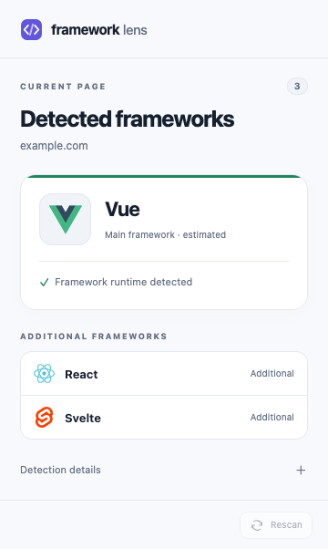

# Framework Lens

A Firefox extension that detects frontend frameworks. It shows the main framework’s colored toolbar icon and lists additional detections in a popup.



Supports **React, Vue, Svelte, Solid, Alpine, Lit, Preact, and Angular**.

## What it does

- Shows the main detected framework’s colored icon in the toolbar.
- Adds a **circular total count** when more than one framework is detected.
- Lists the main and additional frameworks in a popup, with light and dark themes.
- Explains which runtime signals produced each detection.
- Updates on page loads, tab activation and SPA navigation; the popup’s refresh button checks again on demand.

The main framework is an **estimate**: the detector ranks frameworks by the number of sampled DOM elements they own, then by runtime evidence. There is no standard browser API that identifies a website’s “main” framework. If two frameworks have equal evidence, a fixed order breaks the tie; that order does not claim architectural importance.

## Detection, with sources

The detector uses the signals exposed by framework runtimes and recognized by their DevTools: renderer registrations, mounted app and virtual DOM roots, Svelte’s version registry, Solid hydration state, Alpine component state, Lit version/render markers, and Angular’s root version attribute and Ivy view contexts. It reads existing DevTools registrations and leaves their hooks available to the full DevTools extensions.

**It does not bundle or run the full DevTools implementations.** Detection code is written for this extension, with the upstream protocols and deliberate differences documented in [the detection reference](docs/detection.md). Alpine’s browser DevTools are community maintained; Lit detection uses its official runtime rather than claiming an official browser extension exists.

Detection never guesses from framework names in text, asset filenames, CSS classes, or the mere presence of an empty DevTools hook.

### Limits

- The current top-level document and its **open shadow roots** are checked. Embedded frames are excluded, so a React advertisement does not identify an otherwise plain page as React.
- Server-only components can leave no identifiable browser runtime. Svelte builds that disable version disclosure and Solid client-only builds without debug, hydration, or delegated-event markers can be invisible.
- Solid’s `data-hk` attribute follows its DevTools detector but is a weaker SSR signal; the popup labels it as such.
- Angular’s `ng-version` attribute follows its official DevTools detector and can survive server rendering. It does not prove that client bootstrap or hydration has completed.
- Closed shadow roots, browser-protected pages, and frameworks outside the supported eight cannot be inspected.
- Startup observation stops after eight seconds. A framework loaded much later may first appear when you activate the tab, navigate, or open/refresh the popup.
- DOM sampling is bounded. Large or deeply nested pages may produce an incomplete result, indicated in the detection details.
- Websites control their own runtime markers. Detection is informative, not a security or technology audit.

## Install in Firefox

Requires **Firefox 142 or newer**. The package produced here is unsigned.

### Temporary installation, without changing Firefox security settings

1. Run `bun install --frozen-lockfile && bun run build`, or use the already built `extension` folder.
2. Open `about:debugging#/runtime/this-firefox` in Firefox.
3. Click **Load Temporary Add-on…** and select `extension/manifest.json`.
4. Open a website and pin **Framework Lens** to the toolbar from Firefox’s extensions menu.

Firefox removes temporary add-ons when it exits. Existing website tabs are scanned when the extension is installed; reloading a tab also starts detection.

### Persistent installation

`bun run package` creates `dist/framework-lens-1.1.0.xpi`.

For regular Firefox, use a [Mozilla-signed package](https://extensionworkshop.com/documentation/publish/signing-and-distribution-overview/), which can be self-distributed without a public store listing. This repository does not include signing credentials or a signed release.

Firefox Developer Edition also supports a persistent unsigned installation:

1. In `about:config`, set `xpinstall.signatures.required` to `false`. This disables signature enforcement for all add-ons in that profile.
2. Remove any temporary Framework Lens installation from `about:debugging`.
3. Open `about:addons`, choose the gear menu → **Install Add-on From File…**, and select `dist/framework-lens-1.1.0.xpi`.
4. Confirm installation. Framework Lens now remains installed after Firefox exits.

This procedure follows [Mozilla’s Developer Edition installation instructions](https://extensionworkshop.com/documentation/develop/test-permission-requests/). The build and test scripts do not change security settings in your regular Firefox profile.

## Performance and privacy

The installed extension contains plain JavaScript, HTML, CSS, and SVG. **Zero runtime dependencies, no bundler output, no network requests, no analytics, no remote code, and no always-running background page.** Build and testing tools stay out of the installable package.

Each DOM pass visits at most 4,000 elements, yields in roughly 4 ms chunks, and stops after approximately 24 ms of active work. A brief, throttled startup observer handles hydration and disconnects after eight seconds. There are two delayed startup checks, not an endless polling loop. Opening the popup performs a bounded rescan.

Per-tab results live in Firefox’s in-memory session storage and are removed when tabs close. They contain framework IDs, fixed evidence codes, sample counts, and a document token. Page text, browsing history, and URLs are not stored or transmitted.

### Permissions

| Permission                | Purpose                                                                            |
| ------------------------- | ---------------------------------------------------------------------------------- |
| HTTP/HTTPS website access | Read framework runtime markers and update the toolbar automatically.               |
| `scripting`               | Inspect the page’s JavaScript environment, including existing tabs.                |
| `storage`                 | Keep small per-tab results in memory while Firefox suspends the background script. |
| `webNavigation`           | Trigger a scan when an SPA changes route without reloading the document.           |

## Development and verification

Requires **Bun 1.4.4 or newer**. Node.js and npm are not required. Dependencies are pinned in `bun.lock`; `bunfig.toml` forces dependency CLIs to run under Bun and configures the built-in formatter.

```sh
bun install --frozen-lockfile
bun run format:check
bun test
bun run fixtures
bun run package
bun run lint
```

The build scripts use Bun’s file and shell APIs. Bun’s test runner executes the automated checks, and Bun’s bundler builds the production framework fixtures. The package script writes a ZIP/XPI using JSZip under Bun; Python is only needed for the optional Firefox integration tests. Mozilla’s validator is explicitly launched with Bun, overriding its executable’s Node.js shebang.

The package contains only the extension sources and icons. No compilation or dependency code is included in the extension. To regenerate toolbar counters, run `bun run icons`.

Run `bun run format` to format the repository with `bun fmt`. Formatting uses 100-column lines, two spaces, single quotes, no semicolons, and ES5 trailing commas, as configured in `bunfig.toml`.

For integration checks against real, minified production-mode builds of all eight frameworks, plus Angular development and SSR fixtures, in an isolated Firefox profile:

```sh
python3 -m venv .venv
.venv/bin/pip install -r tests/requirements.txt
.venv/bin/python tests/firefox.py
```

On macOS the integration runner uses `/Applications/Firefox Developer Edition.app/Contents/MacOS/firefox`. Set `FIREFOX_BINARY` for another location. Selenium uses geckodriver; the first run may download it. Tests never use or modify your regular Firefox profile.

Framework names and logos belong to their respective owners. [Upstream references and asset credits](docs/detection.md) are included for attribution; this project is independent of those projects.

Made with AI assistance and distributed as is.
